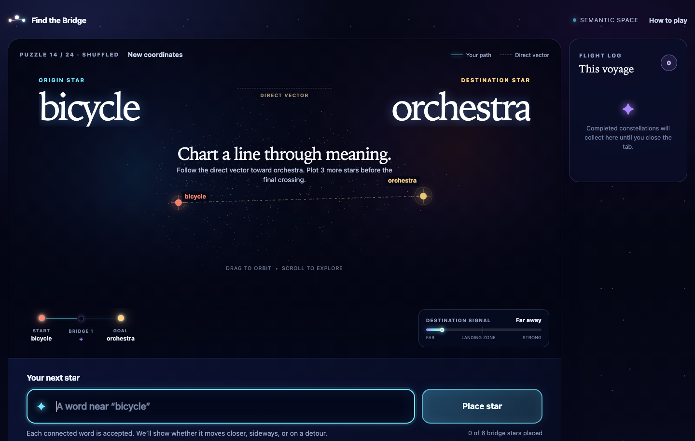

# Find the Bridge

A small browser game about connecting distant ideas with a short chain of words.

[](https://find-the-bridge.t-vasilikioti.chatgpt.site)

The player starts with one word and enters bridge words one at a time. A word is accepted when it is semantically close enough to the current word. The game labels each accepted move as **Closer**, **Sideways**, or **Detour** based on its relationship to the destination. After at least three accepted bridges, the player can finish when the current word is close enough to the destination. Each puzzle allows at most six bridge words and three undos.

## Run locally

The game has no runtime dependencies or build step. Serve the static directory so the browser can load its binary embedding files:

```sh
python3 -m http.server 4173 -d dist
```

Then open `http://localhost:4173`.

Run the scoring checks with:

```sh
node tests/scoring.test.mjs
node tests/embeddings.test.mjs
node scripts/validate-puzzles.mjs
```

## Architecture

- `dist/index.html` contains the game surface and accessible structure.
- `dist/styles.css` contains the responsive visual system.
- `dist/app.js` owns sequential play, local session history, results, Canvas animation, and optional WebMCP actions.
- `dist/scoring.mjs` contains acceptance thresholds, cosine similarity, step labels, and route scoring.
- `dist/data/` contains the fixed vocabulary, quantized vectors, global PCA coordinates, and curated puzzle deck used in the browser.
- `scripts/build-embeddings.mjs` reproduces the static data from a pretrained model.
- `tests/scoring.test.mjs` checks the scoring invariants.

Everything runs in the browser. There is no backend, account, paid API, or network call after the static files load.

## Embeddings

The game uses approximately 10,000 common content words extracted from 50-dimensional GloVe vectors. GloVe is intentionally conservative here: it is small enough for a browser game, well understood, and its pretrained data is distributed under the Public Domain Dedication and License. The source model is `glove-wiki-gigaword-50`, derived from [Stanford GloVe](https://nlp.stanford.edu/projects/glove/). The source vectors already have 50 dimensions; the project does **not** reduce a larger model to 50 dimensions with PCA.

Having the same dimensionality does not mean that the vectors have the same Euclidean length. Every source vector contains 50 coordinates, but its magnitude can differ from that of another word. Each vector is therefore **L2-normalized** offline by dividing it by its magnitude, giving it unit length while retaining its direction. This is normalization, not L2 regularization: regularization is a penalty used while training a model, and this project does not train or fine-tune GloVe.

Cosine similarity already divides by vector magnitude, so normalization is not required by the scoring formula alone. It gives the vectors a consistent scale before 8-bit quantization and PCA. The browser still recomputes both magnitudes during cosine scoring because rounding to signed 8-bit integers introduces small deviations from exact unit length.

The preprocessing pipeline is:

```text
GloVe 50D source vectors
    ↓ select approximately 10,000 words
L2-normalized 50D vectors
    ├── signed 8-bit vectors → cosine similarity and game logic
    └── global PCA to 2D    → flat map and galaxy layout inputs
```

The browser data payload is about 680 KB before transfer compression:

- 500 KB for approximately 10,000 × 50 quantized embedding dimensions.
- 80 KB for two projection coordinates per word.
- About 100 KB for vocabulary and puzzle metadata.

A static CSV would not provide row-level database queries in the browser. Without a server or a separately maintained byte index, the browser would still download and parse the entire CSV. The indexed binary layout is smaller and lets the browser jump directly to a word's fixed-width vector.

The two PCA coordinates are visualization data only. Scoring always uses all 50 dimensions. Increasing the drawing projection to 32 dimensions would not improve a two-dimensional screen visualization; it would only create an intermediate representation that still has to be projected down again.

To rebuild the data, pass a gzipped word2vec-format GloVe file:

```sh
node scripts/build-embeddings.mjs /path/to/glove-wiki-gigaword-50.gz
```

## Future improvements

- Upgrade the current 50-dimensional GloVe vectors to 300 dimensions while preserving the static, browser-only architecture and 8-bit storage. For approximately 10,000 words, this would increase the uncompressed vector payload from about 500 KB to about 3 MB.
- Build a representative benchmark of clearly related and unrelated word pairs, then recalibrate the move-acceptance and destination thresholds against real false positives and false negatives.
- Explore a small association margin for words that make strong progress toward the destination but fall just below the connection threshold for the immediately preceding word.
- Add an optional, privacy-preserving playtesting log or export for rejected guesses so recurring false negatives can be reviewed instead of tuning the model from anecdotes.
- Compare higher-dimensional GloVe with a more modern embedding model. More dimensions should retain additional semantic signal, but a newer model may be needed to substantially improve polysemy and broader human associations.
- Investigate contextual or phrase-level representations so ambiguous words such as `bank` are not limited to a single vector that blends several meanings.
- Replace the galaxy's hybrid layout with a true destination-relative 50D-to-3D linear projection. The first axis would be the normalized vector from the origin word to the destination, while two perpendicular axes would represent deviation from that direct route. This would place the destination genuinely straight ahead, make every plotted position a mathematical projection of the embedding, and preserve the game's central idea of drawing a line through meaning.

## Word acceptance

Words are submitted sequentially instead of filling every slot in advance. A bridge is accepted when:

1. It exists in the fixed vocabulary.
2. It has not already appeared in the route.
3. Its cosine similarity to the current word is at least `0.20`.

The `0.20` threshold deliberately permits lateral “leap” guesses. It is isolated in `scoring.mjs` so playtesting can tune it without changing the interface. Progress toward the destination is guidance rather than a gate: a move is **Closer** when destination similarity rises by at least `0.03`, **Detour** when it falls by at least `0.03`, and **Sideways** in between. This lets players take meaningful lateral routes without accepting unrelated words.

The final crossing becomes available after three bridge words when the current word has at least `0.34` similarity to the destination. If the player reaches six words without that proximity, they can undo and try another direction.

### Tania mode

The header toggle switches to a lateral-thinking variant inspired by finding broad Codenames connections and then discarding the obvious candidates. It keeps the ordinary `0.20` minimum similarity, but adds a minimum cosine **distance** of `0.30`. Because cosine distance is `1 - similarity`, bridge-word similarities must stay within `0.20–0.70`. For example, the bundled vectors place `road → avenue` at about `0.72`, so that near-neighbor is rejected as too obvious. The final crossing is exempt from the upper bound so reaching the named destination is never penalized as a rule violation.

Tania mode scores the route's semantic arc: the sum of every step's cosine distance divided by the direct start-to-destination distance. The 0–100 arc score is weighted 68% toward this detour ratio and 32% toward keeping bridge associations both defensible and non-obvious. The route is still capped at six bridge words and must enter the normal destination landing zone. Switching modes resets the current route while preserving the puzzle and stores the selected mode locally.

The main Tania-mode rule is intentionally written without formulas. An accessible **How distance works** disclosure explains the 50-number word vectors, L2 normalization, cosine distance, the playable band, examples from the bundled model, and why the values are model judgments rather than probabilities or universal truths. Cosine distance theoretically spans `0–2` because cosine similarity spans `-1–1`. Playable bridge distances are narrower: the ordinary similarity floor of `0.20` rejects distances above `0.80`, while Tania mode's non-obviousness rule rejects distances below `0.30`.

During play, a destination-pull meter and the three direction labels show progress without exposing raw embedding values. The meter uses a fixed scale from **Far** through **Landing zone** to **Strong bridge**, so it keeps distinguishing words after the finishing threshold is crossed.

When the final crossing unlocks, a celebratory dialog presents the provisional route score and asks the player to **Finish & see route** or **Keep improving**. Every score display says that higher is better. An additional bridge raises the score only when its stronger connections outweigh the small efficiency penalty for using another word; the player sees the score change immediately and can undo a poor experiment while undos remain. Unused bridge spaces are not rendered as unfinished fields; the route shows only placed words and the single next available space.

## Scoring

The two modes produce 0–100 scores with different meanings, so their scores should not be compared directly. A Regular score measures continuity and efficiency; a Tania score measures creative indirection within defensible limits. Higher final scores are better in both modes.

### Regular mode

Cosine similarity is transformed into step quality on a 0–1 scale. Both similarity and the final 0–100 route score are higher-is-better; the interface consistently calls the raw value **connection strength** so it is not confused with cosine distance, whose direction would be reversed. The quality mapping is a product choice, not a standard embedding formula; it makes raw similarities easier to combine and tune for a game.

```text
continuity =
  50% × geometric mean of step qualities
+ 35% × weakest step
+ 15% × average quality, reduced when steps are inconsistent

score = 100 × continuity × progression × efficiency
```

“Mean quality” is the ordinary average of all normalized step qualities. It is multiplied by a consistency factor, so a route with one unusually weak jump does not receive the same credit as a uniformly strong route.

The geometric mean and explicit weakest-step term ensure that one excellent pair cannot compensate for an implausible jump. Closer moves receive a modest progression advantage over sideways moves and detours, while the efficiency multiplier gives shorter comparable routes a small advantage.

### Tania arc score

Tania mode uses **cosine distance** as its primary vocabulary. For each consecutive pair:

```text
step distance dᵢ = 1 − cosine similarityᵢ
```

Cosine distance mathematically ranges from `0` to `2`, but accepted bridge words cannot exceed `0.80`: the shared move rule rejects similarity below `0.20`. Tania mode also rejects bridge distance below `0.30` as too obvious. Therefore, bridge words must have distance `0.30–0.80`. The final landing is exempt from the lower bound so a close approach to the named destination remains valid.

The arc component compares the total distance travelled with the direct start-to-destination distance:

```text
arc ratio = sum of all step distances ÷ max(0.05, direct start-to-destination distance)
arc quality = clamp((arc ratio − 1) ÷ 3.25, 0, 1)
```

The `0.05` denominator floor avoids unstable ratios for an unusually close start and destination. An arc ratio of `1` follows a route no longer than the direct semantic gap. Arc quality reaches its cap at approximately `4.25×` the direct distance.

The defensibility component scores bridge steps—but not the final landing—on two competing qualities:

```text
connection support = clamp((0.80 − distance) ÷ 0.12, 0, 1)
wildness           = clamp((distance − 0.30) ÷ 0.30, 0, 1)
step defensibility = 45% × connection support + 55% × wildness
```

This creates a strongest-scoring individual-step region around distance `0.60–0.68`: far enough to be surprising, but not so far that the relationship becomes tenuous. The final score is:

```text
Tania score = round(100 × (68% × arc quality + 32% × average defensibility))
```

Unlike Regular mode, Tania mode has no explicit efficiency penalty for additional bridge words. More valid steps can enlarge the arc, but the route is still capped at six bridge words.

## Session history and visualization

Completed scores are stored in `sessionStorage`. They survive refreshes in the same tab but disappear when the tab's session ends. That provides a lightweight sense of a play session without introducing a database or identity system.

Both visualizations use the Canvas API. The completed-route semantic map is a conventional two-dimensional plot of the two offline PCA coordinates. It draws the vocabulary as a faint field, then animates the completed route with a sketch-like line and interactive word markers. Every completed-route crossing is also a real button that spotlights its segment on the map, and the weakest link is labeled explicitly.

The interactive galaxy is currently a deliberately shaped, pseudo-3D explanatory layout rather than a separate three-dimensional projection of all 50 dimensions. Its background stars use the two global PCA coordinates for `x` and `y`, plus the third stored embedding component for `z`. For the played route, `x` directly represents cosine-similarity progress toward the destination, while `y` uses the second PCA coordinate and `z` uses the third embedding component; small deterministic offsets keep consecutive labels and stars visually distinct. The resulting points are rotated in three dimensions and perspective-projected onto the two-dimensional canvas, which provides tilt and zoom effects. Horizontal tilt is constrained so the origin always remains left of the destination.

This hybrid makes progress easy to read and guarantees clear origin and destination positions, but distances in the galaxy should not be interpreted as a rigorous 3D embedding. Acceptance, destination proximity, direction labels, and scoring always use the complete 50-dimensional vectors. The two-dimensional results map is likewise a flattened approximation rather than the space used for judging routes.

L2 normalization is not what makes route words appear close together. Scaling every vector to unit length preserves its direction, so it does not change cosine similarity or cosine distance. The visual compression comes from the hybrid galaxy layout itself: route `x` positions encode destination progress, `y` uses one flattened PCA coordinate, `z` uses one embedding component, and the projected points are constrained to the readable canvas area. Several words with similar destination progress can therefore cluster on screen even when their full 50-dimensional cosine distances are meaningfully different.

A dismissible four-step walkthrough opens on the first visit and remains available from **How to play**. Its dismissed state is stored locally in the browser.

## Puzzle deck

The browser loads 24 curated start/end pairs and shuffles them at the beginning of every session. Reaching the end of the deck reshuffles it while avoiding an immediate repeat. The endpoints remain curated rather than selecting arbitrary vocabulary words, which keeps each round distant but reasonably bridgeable.

Examples include `volcano → bank`, `bee → democracy`, `glacier → coffee`, `feather → justice`, `pillow → space`, and `rocket → courtroom`. The full deck lives in `dist/data/puzzles.json`. Each puzzle also contains a precomputed, curated `strongRoute`. Players can optionally reveal it after finishing; it is presented as another good route rather than an authoritative best answer. `scripts/validate-puzzles.mjs` checks every reference route against the live vocabulary and gameplay thresholds.

## Cloudflare deployment

Cloudflare's current Git setup creates a Worker with static assets rather than showing the older Pages output-directory form. The site is still entirely static: [`wrangler.jsonc`](wrangler.jsonc) tells Cloudflare to publish the committed `dist/` directory.

On the **Configure your Worker project** screen, use:

- Project name: `find-the-bridge`
- Build command: leave empty
- Deploy command: `npx wrangler deploy`
- Preview command: `npx wrangler preview`
- Root directory: leave at the repository root, if that field is shown

Then select **Save and Deploy**. The production branch defaults to the repository's default branch (`main`); after creation, it can be checked under **Settings → Build → Branch control**. Every subsequent push to `main` will produce a production deployment.

The same configuration can be deployed directly from the repository with:

```sh
npx wrangler deploy
```

Daily puzzles, sharing, hints, generated shortest paths, multiplayer, accounts, and phrase embeddings are deliberately deferred.
